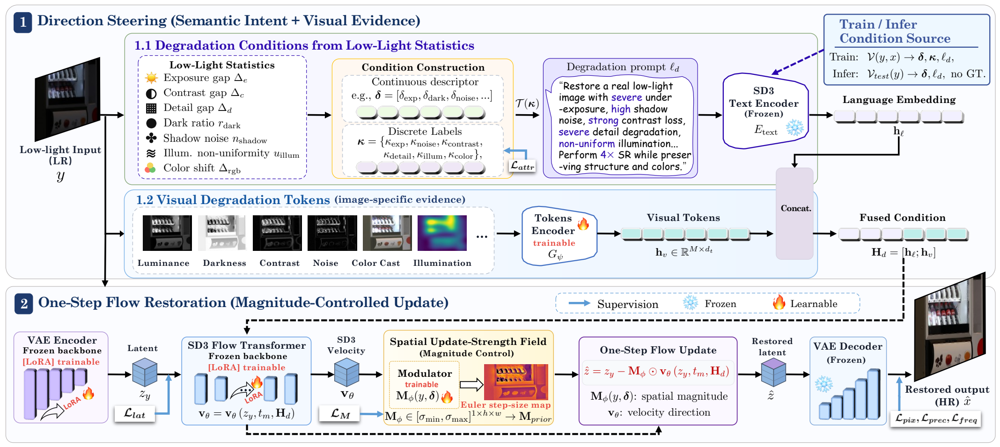
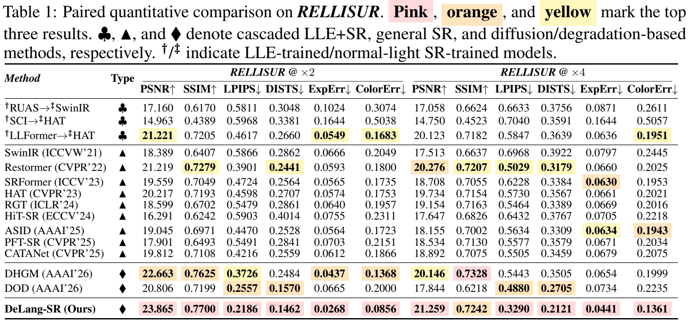

# DeLang-SR

**Decoupling Direction and Magnitude: Language-Steered Flow Matching for Super-Resolution in the Dark**

Jiaxin Gao, Ziyu Yue, Yaohua Liu, Danchen Cui, Zhihui Zhao, Zhixun Su

**NeurIPS 2026**

[Project page](https://moriyaya.github.io/DeLang-SR/) |
[Paper and discussion](https://openreview.net/forum?id=smfrrq0yyf) |
[Pretrained models](https://github.com/moriyaya/DeLang-SR/releases/tag/v1.0.0)

DeLang-SR restores dark low-resolution images with one conditioned SD3 flow update.
Input-derived degradation language and visual tokens steer the restoration
direction; a descriptor-guided spatial field controls the local update magnitude.
Inference conditions use only the low-quality input, with no reference image.



## Installation

Use Python 3.10+ and a CUDA-capable GPU. Install a matching PyTorch/torchvision pair
for your CUDA driver first; the original development dependencies used PyTorch
2.5.1 and torchvision 0.20.1. The release is additionally smoke-tested in the
available server environment; see [reproduction notes](REPRODUCING.md).

```bash
git clone https://github.com/moriyaya/DeLang-SR.git
cd DeLang-SR
python -m venv .venv
source .venv/bin/activate
pip install torch==2.5.1 torchvision==0.20.1 --index-url https://download.pytorch.org/whl/cu124
pip install -r requirements.txt
```

Obtain **Stable Diffusion 3 Medium (Diffusers format)** from the
[official model repository](https://huggingface.co/stabilityai/stable-diffusion-3-medium-diffusers)
and accept its access conditions yourself. Set `SD3_PATH` to the downloaded model
folder. The adapters do not contain the SD3 base weights or text encoders.

## Pretrained x2 and x4 models

```bash
python scripts/download_models.py --scale 2 4
```

The downloader checks archive and per-file SHA-256 hashes. Files are installed in
`checkpoints/delang_sr_x2` and `checkpoints/delang_sr_x4`. Each model contains the
SD3 LoRA, VAE encoder LoRA, and DeLang control modules, and is from the full 20K
training run. Weights are distributed as Release assets, outside Git history.

## Restore an image folder

```bash
export SD3_PATH=/path/to/stable-diffusion-3

python infer/infer_delang_sr.py \
  --input /path/to/low_light_images \
  --output outputs/x2 \
  --checkpoint checkpoints/delang_sr_x2 \
  --sd3_path "$SD3_PATH" --upscale 2

python infer/infer_delang_sr.py \
  --input /path/to/low_light_images \
  --output outputs/x4 \
  --checkpoint checkpoints/delang_sr_x4 \
  --sd3_path "$SD3_PATH" --upscale 4
```

The input may be one image, a folder, or a text list of paths. Outputs retain the
input stem. The script saves `conditions.jsonl` and `run.json` alongside predictions
to record conditioning, dimensions, seed, precision, and processing settings.

The default `--preprocess paper` follows the original benchmark preprocessing:
small inputs may be enlarged so that the processing side reaches 1024. For exact
`scale * input` output dimensions on arbitrary images, use `--preprocess native`.
Do not mix these protocols in a quantitative comparison. See
[reproduction notes](REPRODUCING.md) for conditioning and tiling details.

## Evaluate and compare

```bash
pip install -r requirements-eval.txt
python scripts/eval_fr_iqa_methods.py --pred_dir outputs/x2 \
  --gt_dir /path/to/GT_X2 --output_dir evaluations/fr --method DeLang-SR-x2
python scripts/eval_nr_iqa_methods.py --pred_dir outputs/x2 \
  --output_dir evaluations/nr --method DeLang-SR-x2
```

Full-reference metrics: PSNR, SSIM, LPIPS, DISTS, ExpErr, ColorErr. No-reference
metrics: NIQE, MUSIQ, MANIQA, CLIP-IQA; these do not take GT as an input. Each
evaluation writes per-image Excel/CSV, summary JSON, and a LaTeX row. The scripts
also accept `--methods_root` for multiple method folders. Verify the reported
number of images, missing pairs, and shape mismatches before using an average.

## Training

Training requires paired LQ/HQ data, the SD3 base model, and the official DINOv3
repository and ConvNeXt-Large pretrained weights. DINOv3 is used only for the
training loss. Follow the setup and commands in [TRAINING.md](TRAINING.md).
Only the full DeLang-SR implementation is included in this release.

## RELLISUR results

The table below is reproduced directly from the camera-ready paper. Evaluation
uses 425 test pairs, RGB PSNR/SSIM, and the metric definitions in
`scripts/eval_fr_iqa_methods.py`.



## Citation

```bibtex
@inproceedings{gao2026delangsr,
  title={Decoupling Direction and Magnitude: Language-Steered Flow Matching for Super-Resolution in the Dark},
  author={Gao, Jiaxin and Yue, Ziyu and Liu, Yaohua and Cui, Danchen and Zhao, Zhihui and Su, Zhixun},
  booktitle={Advances in Neural Information Processing Systems},
  year={2026}
}
```

## Acknowledgements and terms

This implementation builds on [OMGSR](https://github.com/wuer5/OMGSR),
[Diffusers](https://github.com/huggingface/diffusers),
[PEFT](https://github.com/huggingface/peft), and
[DINOv3](https://github.com/facebookresearch/dinov3). Evaluation uses
[PyIQA](https://github.com/chaofengc/IQA-PyTorch).
Please retain the third-party notices and follow the applicable code/model terms
in [THIRD_PARTY_NOTICES.md](THIRD_PARTY_NOTICES.md).
